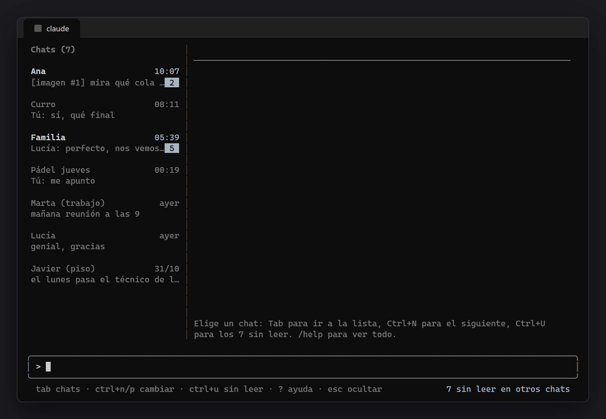
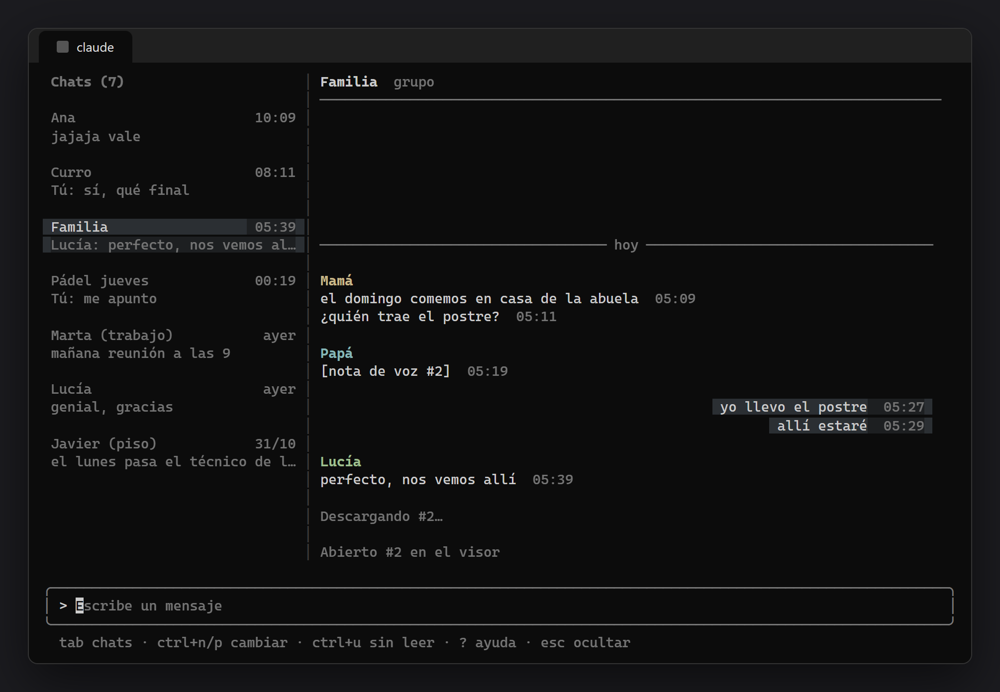
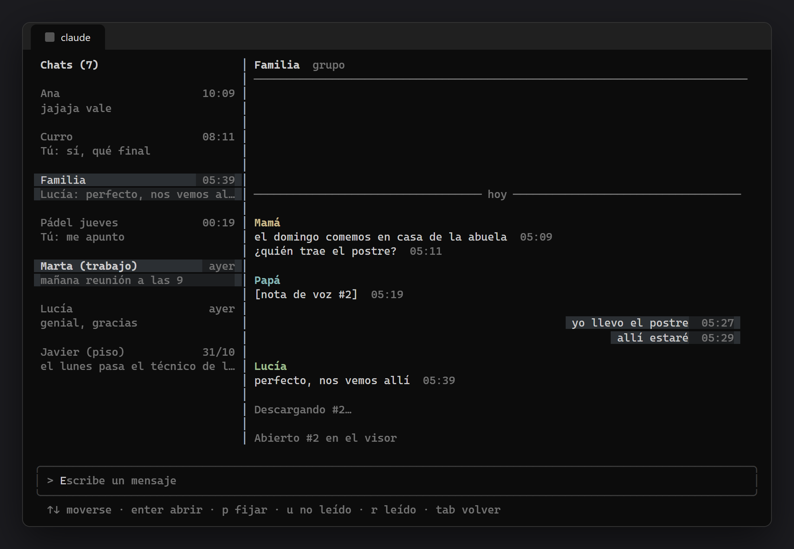
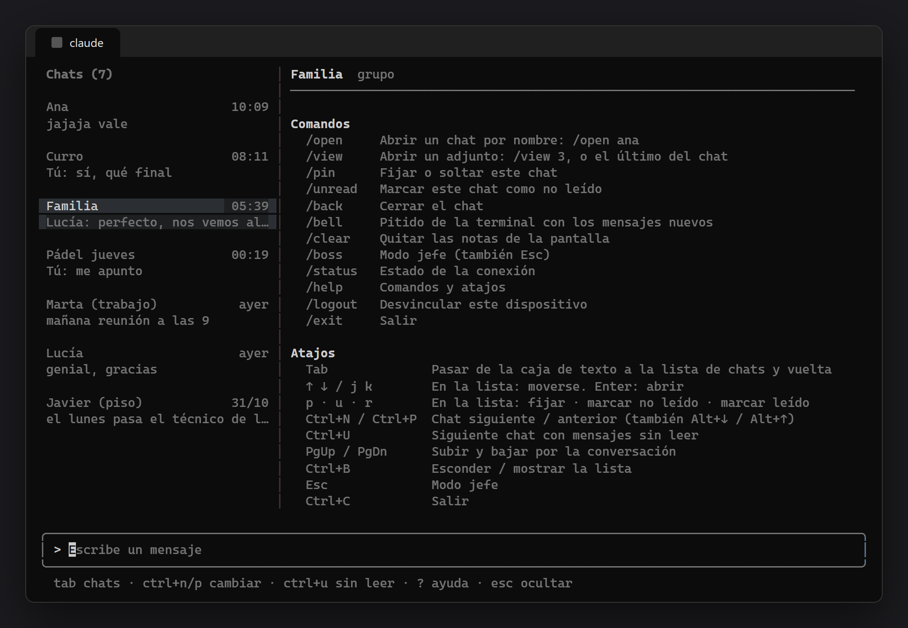

# wa-terminal

WhatsApp en la terminal: un chat normal y sobrio, en negro y con colores
apagados, que en una oficina pasa por una herramienta de desarrollo más. Si
alguien se acerca, **Esc** lo tapa todo con una sesión de Claude Code de mentira
haciendo un refactor.


- Lista de chats con nombre, hora, vista previa y mensajes sin leer, como en el
  móvil.
- Tus mensajes a la derecha y los del otro a la izquierda, con la hora. En los
  grupos, cada persona con su color.
- «escribiendo…» cuando el otro está escribiendo.
- Fotos, vídeos, audios y documentos, que se abren en el visor de Windows.
- Atajos de teclado para moverse entre chats sin tocar el ratón.
- Al salir, la terminal vuelve a como estaba, sin rastro de los mensajes.

> **Aviso.** Usa [Baileys](https://github.com/WhiskeySockets/Baileys), un
> cliente **no oficial** de WhatsApp. Puede acabar en baneo del número. Lee
> [Riesgo](#riesgo) antes de usarlo.

## Índice

- [Instalar](#instalar)
- [Vincular el móvil](#vincular-el-móvil)
- [Uso](#uso)
- [Atajos de teclado](#atajos-de-teclado)
- [Comandos](#comandos)
- [Adjuntos](#adjuntos)
- [Modo jefe](#modo-jefe)
- [Riesgo](#riesgo)
- [Datos en disco](#datos-en-disco)
- [Desarrollo](#desarrollo)

## Instalar

Hace falta **Node.js 22 o posterior**.

```powershell
git clone git@github.com-personal:VolmerES/wa-terminal.git
cd wa-terminal
npm install
```

Para verlo sin vincular nada, con chats de mentira:

```powershell
npm run demo
```

## Vincular el móvil

```powershell
npm start
```

La primera vez sale un QR. En el móvil: **Ajustes → Dispositivos vinculados →
Vincular un dispositivo**, y lo escaneas.

- El QR sale en la terminal, que tiene que medir al menos 70 columnas y unas 45
  filas. Además se abre solo como imagen, `data/qr.png`, que es lo que mejor se
  escanea.
- El QR cambia cada ~20 segundos. Si la imagen abierta ya no vale, vuelve a
  abrir `data/qr.png`.
- **Sin QR**: vincula con tu número (con prefijo, sin `+`):

  ```powershell
  npm start -- --pair=34600111222
  ```

  En la terminal sale un código de 8 letras. En el móvil: **Vincular un
  dispositivo → Vincular con el número de teléfono**, y lo escribes.

La sesión se guarda en `data/auth/`. Las siguientes veces entra directamente.

## Uso



A la izquierda, la lista de chats; a la derecha, la conversación; abajo, la caja
de texto. Para empezar:

1. **Ctrl+U** abre el siguiente chat con mensajes sin leer.
2. O **Tab** para ir a la lista, **↑ ↓** para elegir y **Enter** para abrir.
3. O `/open ana` para abrirlo por nombre.

Con un chat abierto, lo que escribas en la caja y mandes con Enter **se envía**.
Arriba de la conversación siempre sale con quién estás hablando.

Al abrir un chat, sus mensajes se marcan como leídos en WhatsApp (salen los
ticks azules, si los tienes activados).



### En la lista de chats



| Marca | Qué significa |
|---|---|
| **Nombre en negrita** y número | Mensajes sin leer, y cuántos |
| `●` | Lo marcaste como no leído |
| `◆` | Fijado: va siempre arriba |
| *escribiendo…* | El otro está escribiendo ahora |
| Fondo gris | El chat abierto o el seleccionado |

Abajo a la derecha sale cuántos mensajes sin leer tienes en otros chats.

La pestaña de la terminal pasa a llamarse `claude` mientras está abierto.

## Atajos de teclado

| Tecla | Dónde | Qué hace |
|---|---|---|
| **Tab** | siempre | Pasa de la caja de texto a la lista de chats, y vuelta |
| **↑ ↓** o **j k** | lista | Moverse por los chats |
| **Enter** | lista | Abrir el chat seleccionado |
| **→** | lista | Volver a la caja de texto |
| **p** | lista | Fijar o soltar el chat (va arriba del todo) |
| **u** | lista | Marcar como no leído |
| **r** | lista | Marcar como leído |
| **Ctrl+N** / **Alt+↓** | siempre | Abrir el chat siguiente de la lista |
| **Ctrl+P** / **Alt+↑** | siempre | Abrir el chat anterior |
| **Ctrl+U** | siempre | Abrir el siguiente chat con mensajes sin leer |
| **PgUp** / **PgDn** | siempre | Subir y bajar por la conversación |
| **Ctrl+B** | siempre | Esconder o mostrar la lista de chats |
| **Esc** | siempre | Modo jefe, y vuelta |
| **Ctrl+C** | siempre | Salir |

En la caja de texto: **← →** mueven el cursor, **Inicio / Fin** (o **Ctrl+A /
Ctrl+E**) van al principio y al final, y **Ctrl+W** borra la palabra anterior.

Fijar y marcar como leído o no leído desde la lista es **solo en local**: no
cambia nada en el móvil. La excepción es **r**, que además manda la confirmación
de lectura.

## Comandos

Se escriben en la caja de texto. Al escribir `/` aparece una sugerencia del
comando abajo.



| Comando | Atajo | Qué hace |
|---|---|---|
| `/open <nombre>` | `/o` | Abre el primer chat cuyo nombre contenga ese texto. Sin tildes ni mayúsculas: `/open lucia` abre «Lucía» |
| `/view [n]` | `/v` | Descarga y abre un adjunto. Sin número, el último del chat abierto; con número, ese: `/view 3` abre el `[imagen #3]` |
| `/pin` | | Fija o suelta el chat abierto |
| `/unread` | | Marca el chat abierto como no leído y lo cierra |
| `/back` | `/b` | Cierra el chat abierto |
| `/chats` | `/c` | Va a la lista de chats (como **Tab**) |
| `/bell` | | Enciende o apaga el pitido de la terminal con los mensajes nuevos de otros chats. Viene apagado |
| `/clear` | | Quita de la pantalla las notas (ayuda, avisos, errores) |
| `/boss` | | Modo jefe (como **Esc**) |
| `/status` | | Estado de la conexión y número de chats |
| `/help` | `?` | Comandos y atajos |
| `/logout` | | Desvincula este ordenador de tu WhatsApp y borra la sesión |
| `/exit` | `/quit` | Salir (como **Ctrl+C**) |

## Adjuntos

Fotos, vídeos, audios, notas de voz, stickers y documentos salen en la
conversación con un número: `[imagen #3] mira qué cola hay`.

- `/view` abre el último del chat; `/view 3`, el `#3`.
- Se descargan a `data/media/` y se abren con la aplicación que tenga Windows
  para ese tipo de fichero. La segunda vez ya no se descargan.
- Si un adjunto es antiguo y WhatsApp ya no lo tiene en sus servidores, se le
  pide al móvil que lo vuelva a subir; para eso tiene que estar encendido.
- Los que salen como `[imagen, no disponible]` se guardaron con una versión
  anterior del programa, sin los datos para descargarlos, y no se pueden abrir.

## Modo jefe


**Esc** cambia la pantalla entera a una sesión de Claude Code de mentira: un
árbol de ficheros a la izquierda y, a la derecha, un refactor que avanza solo,
con búsquedas, lecturas de ficheros, diffs y tests en verde, y el spinner de
«Thinking…» abajo. Otro **Esc** devuelve el chat como estaba.

- En modo jefe **no se envía nada a WhatsApp**: lo que escribas aparece como un
  prompt más.
- Los mensajes siguen llegando por debajo. Abajo a la derecha se cuentan como
  `● 2 background tasks`.
- El guion está en `src/boss.js`, por si quieres cambiar el proyecto o las
  frases.

## Riesgo

Baileys habla con los servidores de WhatsApp sin ser la app oficial, y eso va
contra sus condiciones. **Puede acabar en baneo**, temporal o permanente. Con uso
normal es poco probable, pero pasa más con números nuevos o si se mandan muchos
mensajes. Un baneo temporal se pasa solo; uno permanente se puede recurrir desde
la app, pero no hay garantía de recuperar el número.

Para reducir el riesgo, el cliente:

- no se pone «en línea» al conectar,
- no pide el historial completo,
- se presenta como WhatsApp de escritorio para Windows,
- reconecta esperando cada vez más, sin insistir,
- solo envía lo que escribes tú, nada automático.

No lo uses para envíos masivos ni para escribir a desconocidos.

## Datos en disco

Todo va a `data/`, que **no se sube a git**:

| Qué | Para qué | Cuidado |
|---|---|---|
| `data/auth/` | La sesión vinculada | Quien tenga esta carpeta puede leer y escribir tu WhatsApp. No la copies ni la compartas |
| `data/store.json` | Los últimos 150 mensajes de cada chat y los nombres, para tenerlos al volver a abrir | En un ordenador del trabajo, tenlo en cuenta. Se puede borrar cuando quieras |
| `data/media/` | Los adjuntos que has abierto con `/view` | Igual que el anterior |
| `data/qr.png` | El QR mientras vinculas | Se borra solo al vincular |
| `data/wa.log` | Avisos y errores de Baileys | |

Con la variable `WA_TERMINAL_DATA` se puede poner esa carpeta en otro sitio.

Para desvincular de verdad, `/logout`, o en el móvil **Dispositivos vinculados →
el dispositivo → Cerrar sesión**.

## Desarrollo

```powershell
npm run demo       # la app con chats de mentira
npm test           # renderiza la demo en una terminal simulada, pulsa teclas y vuelca las pantallas
npm run capturas   # rehace las capturas de docs/capturas/ (usa el Chrome instalado)
```

Las capturas salen siempre de la demo, nunca de chats reales.

| Fichero | Qué hace |
|---|---|
| `src/index.js` | Arranque y opciones (`--demo`, `--pair=`) |
| `src/ui.js` | La interfaz, con [Ink](https://github.com/vadimdemedes/ink) a pantalla completa |
| `src/input.js` | La caja de texto, propia para que los atajos no se escriban en el mensaje |
| `src/wa.js` | La conexión con Baileys: mensajes, nombres, «escribiendo», adjuntos |
| `src/store.js` | Chats, mensajes y nombres, guardados en `data/store.json` |
| `src/demo.js` | El backend de mentira de `npm run demo` |
| `src/boss.js` | El guion y el árbol de ficheros del modo jefe |
| `scripts/capturas.js` | Genera las capturas |
| `test/smoke.js` | Prueba de humo de la interfaz |
