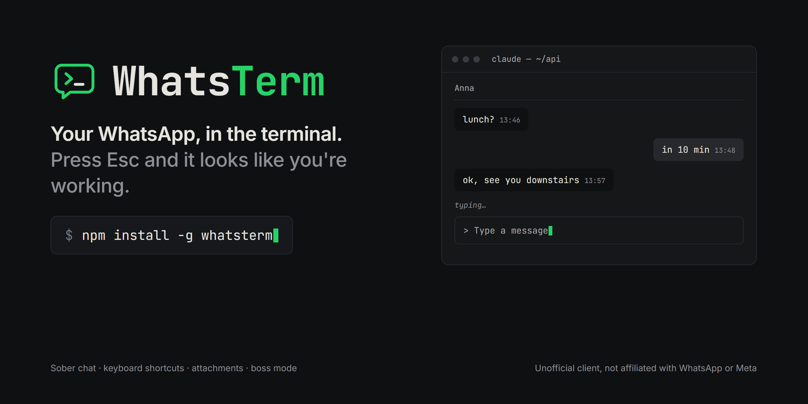
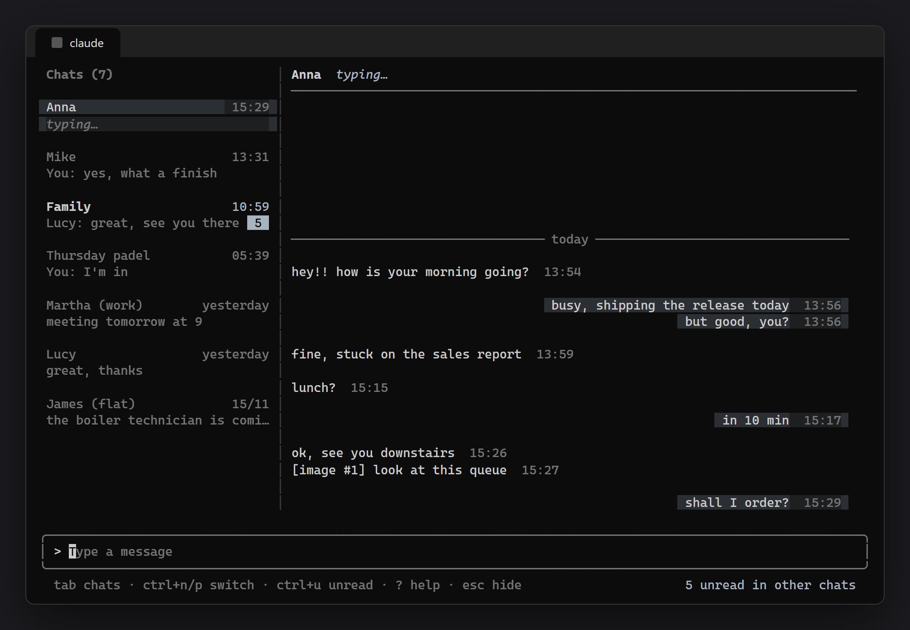
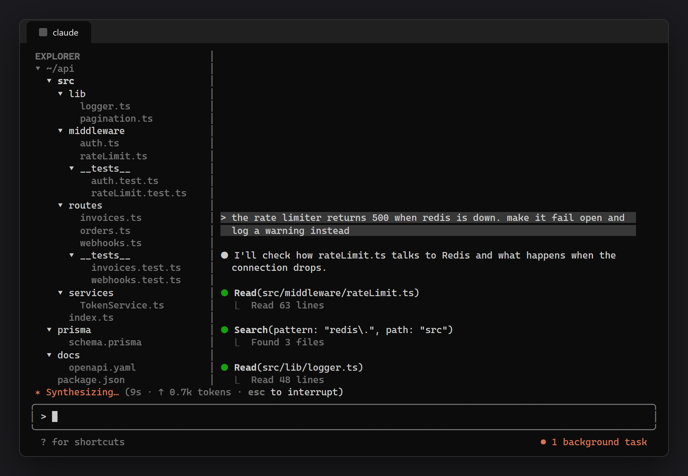
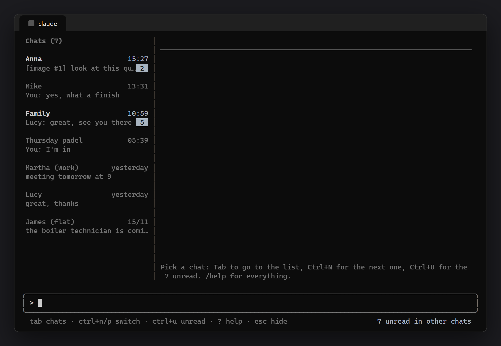
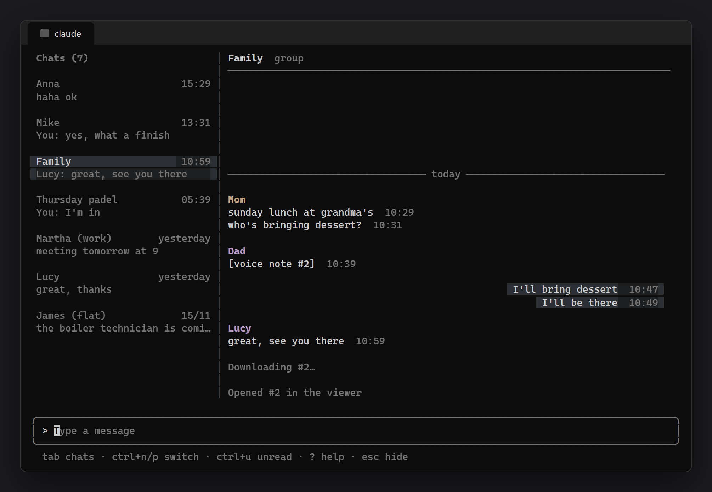
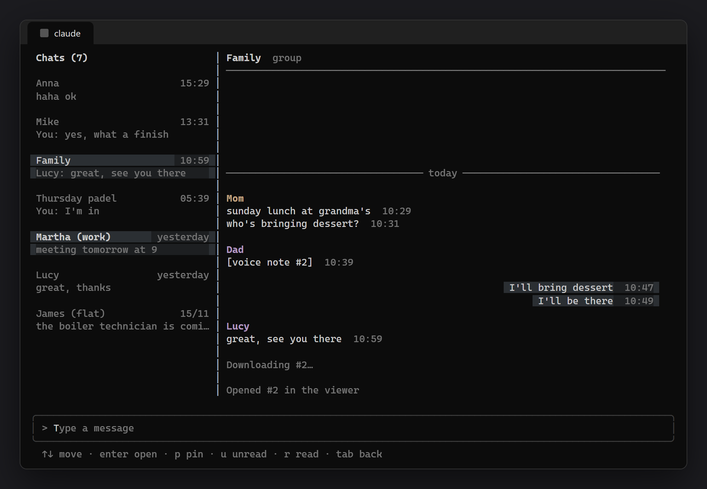
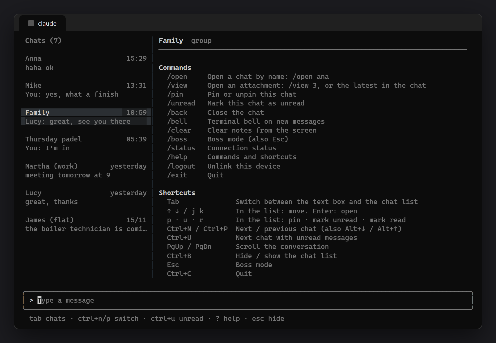

<p align="center">
  
</p>

<p align="center">
  <a href="https://www.npmjs.com/package/whatsterm"></a>
  
  <a href="LICENSE"></a>
</p>

<p align="center">
  <b>Your WhatsApp, in the terminal.</b> A sober chat, black with muted colors,<br>
  that passes for just another dev tool at the office.<br>
  If someone walks by, <b>Esc</b> covers everything with a fake Claude Code session.
</p>

> [!WARNING]
> **WhatsTerm is an unofficial client.** It is not affiliated with, endorsed by
> or connected to WhatsApp or Meta; WhatsApp is a trademark of WhatsApp LLC. It
> uses [Baileys](https://github.com/WhiskeySockets/Baileys), which goes against
> WhatsApp's Terms of Service: **your number could get banned**. Read
> [Risk](#risk) before using it.

## Getting started

```sh
npm install -g whatsterm   # requires Node.js 22 or later
whatsterm --demo           # try it with fake chats, nothing to link
whatsterm                  # the real thing: scan the QR with your phone and you're in
```

You can also launch it as `wat`, shorter and more discreet.



## Features

| | |
|---|---|
| **Chats like on your phone** | A list with name, time, preview and unread count. Yours on the right, theirs on the left; in groups, each person gets their own color |
| **"typing…"** | You can see when the other person is typing |
| **Attachments** | Photos, videos, audio and documents, opened with your system's default app |
| **Keyboard only** | Shortcuts to move between chats, pin them and mark them without touching the mouse |
| **Boss mode** | **Esc** and the screen turns into a coding agent at work. **Esc** again and you're back |
| **No trace** | When you quit, the terminal goes back to how it was, with no messages left in the scrollback |



## Contents

- [Install and update](#install-and-update)
- [Link your phone](#link-your-phone)
- [Usage](#usage)
- [Keyboard shortcuts](#keyboard-shortcuts)
- [Commands](#commands)
- [Attachments](#attachments)
- [Boss mode](#boss-mode)
- [Risk](#risk)
- [Data on disk](#data-on-disk)
- [FAQ](#faq)
- [Contributing](#contributing)
- [Development](#development)

## Install and update

Requires **Node.js 22 or later** ([nodejs.org](https://nodejs.org)).

```sh
npm install -g whatsterm          # install
npm install -g whatsterm@latest   # update
npm uninstall -g whatsterm        # uninstall
whatsterm --version               # which version you have
```

Neither updating nor uninstalling deletes your session or messages (see
[Data on disk](#data-on-disk)). It's built and tested on **Windows** (Windows
Terminal); it should work on macOS and Linux, but those are less tested.

## Link your phone

```sh
whatsterm
```

The first time, a QR code shows up. On your phone: **Settings → Linked devices →
Link a device**, and scan it.

- The QR is drawn in the terminal, which needs to be at least 70 columns by
  about 45 rows. It also opens on its own as an image, `qr.png` in the data
  folder, which is the easiest to scan.
- The QR changes every ~20 seconds. If the open image no longer works, open
  `qr.png` again.
- **No QR**: link with your phone number (with country code, no `+`):

  ```sh
  whatsterm --pair=14155550123
  ```

  An 8-letter code shows up in the terminal. On your phone: **Link a device →
  Link with phone number instead**, and type it in.

The session is saved in `auth/`, inside the data folder. After that, it connects straight away.

## Usage



The chat list is on the left, the conversation on the right and the text box at
the bottom. To get started:

1. **Ctrl+U** opens the next chat with unread messages.
2. Or **Tab** to go to the list, **↑ ↓** to choose and **Enter** to open.
3. Or `/open anna` to open it by name.

With a chat open, whatever you type in the box and send with Enter **is sent**.
The top of the conversation always shows who you're talking to.

Opening a chat marks its messages as read on WhatsApp (blue ticks, if you have
them turned on).



### In the chat list



| Marker | Meaning |
|---|---|
| **Bold name** and a number | Unread messages, and how many |
| `●` | You marked it as unread |
| `◆` | Pinned: always at the top |
| *typing…* | The other person is typing right now |
| Grey background | The open or selected chat |

The bottom right shows how many unread messages you have in other chats.

The terminal tab is renamed to `claude` while it's running.

## Keyboard shortcuts

| Key | Where | What it does |
|---|---|---|
| **Tab** | anywhere | Switches between the text box and the chat list |
| **↑ ↓** or **j k** | list | Move through the chats |
| **Enter** | list | Open the selected chat |
| **→** | list | Back to the text box |
| **p** | list | Pin or unpin the chat (goes to the top) |
| **u** | list | Mark as unread |
| **r** | list | Mark as read |
| **Ctrl+N** / **Alt+↓** | anywhere | Open the next chat in the list |
| **Ctrl+P** / **Alt+↑** | anywhere | Open the previous chat |
| **Ctrl+U** | anywhere | Open the next chat with unread messages |
| **PgUp** / **PgDn** | anywhere | Scroll the conversation |
| **Ctrl+B** | anywhere | Hide or show the chat list |
| **Esc** | anywhere | Boss mode, and back |
| **Ctrl+C** | anywhere | Quit |

In the text box: **← →** move the cursor, **Home / End** (or **Ctrl+A /
Ctrl+E**) jump to the start and end, and **Ctrl+W** deletes the previous word.

Pinning and marking as read or unread from the list is **local only**: nothing
changes on your phone. The exception is **r**, which also sends the read receipt.

## Commands

Type them in the text box. When you type `/`, a suggestion for the command shows
up at the bottom.



| Command | Short | What it does |
|---|---|---|
| `/open <name>` | `/o` | Opens the first chat whose name contains that text. Accents and case don't matter: `/open lucia` opens "Lucía" |
| `/view [n]` | `/v` | Downloads and opens an attachment. Without a number, the latest in the open chat; with a number, that one: `/view 3` opens `[image #3]` |
| `/pin` | | Pins or unpins the open chat |
| `/unread` | | Marks the open chat as unread and closes it |
| `/back` | `/b` | Closes the open chat |
| `/chats` | `/c` | Goes to the chat list (like **Tab**) |
| `/bell` | | Turns the terminal bell for new messages in other chats on or off. Off by default |
| `/clear` | | Clears notes from the screen (help, notices, errors) |
| `/boss` | | Boss mode (like **Esc**) |
| `/status` | | Connection status and number of chats |
| `/help` | `?` | Commands and shortcuts |
| `/logout` | | Unlinks this computer from your WhatsApp and deletes the session |
| `/exit` | `/quit` | Quit (like **Ctrl+C**) |

## Attachments

Photos, videos, audio, voice notes, stickers and documents show up in the
conversation with a number: `[image #3] look at this queue`.

- `/view` opens the latest one in the chat; `/view 3`, number `#3`.
- They're downloaded to `media/`, in the data folder, and opened with your
  system's default app for that file type. The second time, they're not
  downloaded again.
- If an attachment is old and WhatsApp no longer has it on its servers, the
  phone is asked to upload it again; for that it needs to be on.
- The ones shown as `[image, unavailable]` were saved by an older version of the
  program without the data needed to download them, and can't be opened.

## Boss mode

**Esc** switches the whole screen to a fake Claude Code session: a file tree on
the left and, on the right, an agent working on its own, with searches, file
reads, diffs and green tests, and the "Thinking…" spinner at the bottom. **Esc**
again brings the chat back exactly as it was.

- **It never ends.** There are six tasks (a refactor, adding pagination, a
  Redis bug, duplicate webhooks, logging, a slow query) that play back to back
  in random order, with different numbers and pacing each time. A full round
  takes about 4 minutes, and the next one comes in a different order.
- Between tasks there's a pause, as if you were typing the next prompt, and the
  tree marks the files the current task is editing.
- In boss mode **nothing is sent to WhatsApp**: whatever you type shows up as
  another prompt.
- Messages keep arriving underneath. The bottom right counts them as
  `● 2 background tasks`.
- The tasks live in [`src/boss.js`](src/boss.js), in case you want to change the
  project, the wording, or add your own.

## Risk

Baileys talks to WhatsApp's servers without being the official app, and that
goes against their terms. **It can get you banned**, temporarily or
permanently. With normal use it's unlikely, but it happens more with new numbers
or when sending lots of messages. A temporary ban lifts on its own; a permanent
one can be appealed from the app, but there's no guarantee of getting the number
back.

To lower the risk, the client:

- doesn't go "online" when it connects,
- doesn't request the full history,
- identifies as WhatsApp Desktop for Windows,
- reconnects with growing waits, without insisting,
- only sends what you type, nothing automatic.

Don't use it for bulk messaging or to message strangers.

## Data on disk

Everything goes to the `.whatsterm` folder in your home directory
(`C:\Users\<you>\.whatsterm` on Windows, `~/.whatsterm` on macOS and Linux). If
you run the code from a clone of the repo and there's a `data/` folder next to
it, that one is used.

| What | What for | Careful |
|---|---|---|
| `auth/` | The linked session | Anyone with this folder can read and write your WhatsApp. Don't copy or share it |
| `store.json` | The last 150 messages of each chat and the contact names, so they're there next time | Keep it in mind on a work computer. You can delete it any time |
| `media/` | Attachments you've opened with `/view` | Same as above |
| `qr.png` | The QR while you link | Deleted automatically once linked |
| `wa.log` | Baileys warnings and errors | |

The `WHATSTERM_DATA` environment variable lets you put that folder somewhere else.

To really unlink, use `/logout`, or on your phone **Linked devices → the
device → Log out**.

## FAQ

**Does my phone need to be on?** Only to link and to recover old attachments.
After that it works like WhatsApp Web: the computer is just another linked
device.

**Can anyone else read my messages?** No. WhatsTerm talks directly to WhatsApp's
servers from your computer. There's no server in between and it doesn't send
anything anywhere else.

**Can I use it on my work computer?** Technically yes; that's what boss mode is
for. But it keeps the latest messages on disk (see
[Data on disk](#data-on-disk)) and whoever has the `auth/` folder has your
WhatsApp. Your call.

**The QR won't scan.** Make the terminal bigger (70×45 at least), open the
`qr.png` image in the data folder, or link with your number:
`whatsterm --pair=14155550123`.

**Why is the tab called `claude`?** So boss mode is believable from the outside
too.

## Contributing

Bugs and ideas go to the [issues](https://github.com/VolmerES/WhatsTerm/issues).
Pull requests and suggestions for improvement are very welcome; run `npm test`
before opening one. New fake tasks for boss mode are a great first PR. The only
rule: nothing that sends messages automatically or in bulk, because that's
exactly what gets accounts banned.

## Development

```sh
git clone https://github.com/VolmerES/WhatsTerm.git
cd WhatsTerm
npm install
npm start             # the real app
npm run demo          # the app with fake chats
npm test              # renders the demo in a simulated terminal, presses keys and dumps the screens
npm run screenshots   # regenerates docs/screenshots/ (uses your installed Chrome)
```

Screenshots always come from the demo, never from real chats.

| File | What it does |
|---|---|
| `src/index.js` | Startup and options (`--demo`, `--pair=`, `--version`) |
| `src/ui.js` | The full-screen UI, built with [Ink](https://github.com/vadimdemedes/ink) |
| `src/input.js` | The text box, custom so shortcuts don't get typed into the message |
| `src/wa.js` | The Baileys connection: messages, names, "typing", attachments |
| `src/store.js` | Chats, messages and names, saved to `store.json` |
| `src/demo.js` | The fake backend behind `npm run demo` |
| `src/boss.js` | The boss mode tasks and file tree |
| `scripts/screenshots.js` | Generates the screenshots |
| `test/smoke.js` | UI smoke test |
| `docs/brand/` | Logo, icon and banner (green `#25D366` on `#0F1012`, JetBrains Mono and Inter) |

## License

[MIT](LICENSE). You can use, modify and redistribute it as long as you keep the
copyright notice. It's provided as is, without warranty: the risk of a ban is on
whoever uses it.
