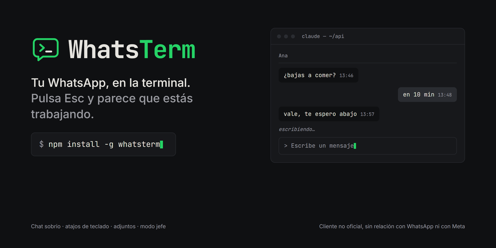
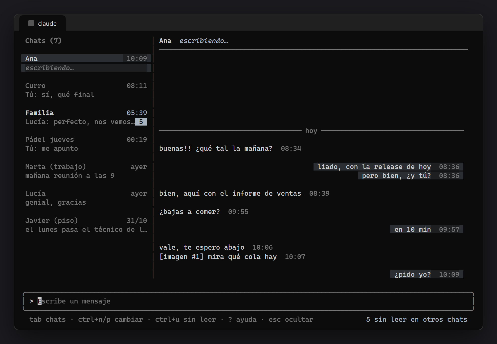
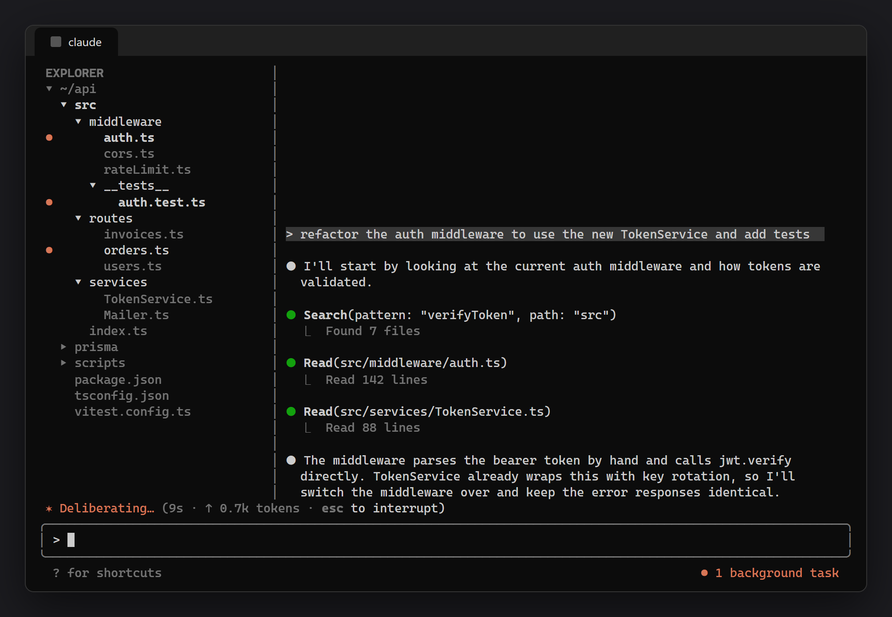

<p align="center">
  
</p>

<p align="center">
  <a href="https://www.npmjs.com/package/whatsterm"></a>
  
  <a href="LICENSE"></a>
</p>

<p align="center">
  <b>Tu WhatsApp, en la terminal.</b> Un chat sobrio, en negro y con colores apagados,<br>
  que en una oficina pasa por una herramienta de desarrollo más.<br>
  Si alguien se acerca, <b>Esc</b> lo tapa todo con una sesión de Claude Code de mentira.
</p>

> [!WARNING]
> **WhatsTerm es un cliente no oficial.** No tiene ninguna relación con WhatsApp
> ni con Meta, ni está respaldado por ellos; WhatsApp es una marca de WhatsApp
> LLC. Usa [Baileys](https://github.com/WhiskeySockets/Baileys) y eso va contra
> las condiciones de WhatsApp: **puede acabar en baneo del número**. Lee
> [Riesgo](#riesgo) antes de usarlo.

## Empezar

```sh
npm install -g whatsterm   # hace falta Node.js 22 o posterior
whatsterm --demo           # pruébalo con chats de mentira, sin vincular nada
whatsterm                  # el de verdad: escanea el QR con el móvil y listo
```

También se puede lanzar como `wat`, más corto y más discreto.



## Qué hace

| | |
|---|---|
| **Chats como en el móvil** | Lista con nombre, hora, vista previa y mensajes sin leer. Los tuyos a la derecha, los del otro a la izquierda; en los grupos, cada persona con su color |
| **«escribiendo…»** | Ves cuándo el otro está escribiendo |
| **Adjuntos** | Fotos, vídeos, audios y documentos, que se abren con la aplicación del sistema |
| **Solo teclado** | Atajos para moverse entre chats, fijarlos y marcarlos sin tocar el ratón |
| **Modo jefe** | **Esc** y la pantalla pasa a ser un refactor en curso. Otro **Esc** y vuelves |
| **Sin rastro** | Al salir, la terminal vuelve a como estaba, sin los mensajes en el historial |



## Índice

- [Instalar y actualizar](#instalar-y-actualizar)
- [Vincular el móvil](#vincular-el-móvil)
- [Uso](#uso)
- [Atajos de teclado](#atajos-de-teclado)
- [Comandos](#comandos)
- [Adjuntos](#adjuntos)
- [Modo jefe](#modo-jefe)
- [Riesgo](#riesgo)
- [Datos en disco](#datos-en-disco)
- [Preguntas frecuentes](#preguntas-frecuentes)
- [Contribuir](#contribuir)
- [Desarrollo](#desarrollo)

## Instalar y actualizar

Hace falta **Node.js 22 o posterior** ([nodejs.org](https://nodejs.org)).

```sh
npm install -g whatsterm          # instalar
npm install -g whatsterm@latest   # actualizar
npm uninstall -g whatsterm        # desinstalar
whatsterm --version               # qué versión tienes
```

Ni actualizar ni desinstalar borran la sesión ni los mensajes (ver
[Datos en disco](#datos-en-disco)). Está hecho y probado en **Windows**
(Windows Terminal); en Mac y Linux debería funcionar, pero está menos probado.

## Vincular el móvil

```sh
whatsterm
```

La primera vez sale un QR. En el móvil: **Ajustes → Dispositivos vinculados →
Vincular un dispositivo**, y lo escaneas.

- El QR sale en la terminal, que tiene que medir al menos 70 columnas y unas 45
  filas. Además se abre solo como imagen, `qr.png` en la carpeta de datos, que
  es lo que mejor se escanea.
- El QR cambia cada ~20 segundos. Si la imagen abierta ya no vale, vuelve a
  abrir `qr.png`.
- **Sin QR**: vincula con tu número (con prefijo, sin `+`):

  ```sh
  whatsterm --pair=34600111222
  ```

  En la terminal sale un código de 8 letras. En el móvil: **Vincular un
  dispositivo → Vincular con el número de teléfono**, y lo escribes.

La sesión se guarda en `auth/`, dentro de la carpeta de datos. Las siguientes veces entra directamente.

## Uso


A la izquierda, la lista de chats; a la derecha, la conversación; abajo, la caja
de texto. Para empezar:

1. **Ctrl+U** abre el siguiente chat con mensajes sin leer.
2. O **Tab** para ir a la lista, **↑ ↓** para elegir y **Enter** para abrir.
3. O `/open ana` para abrirlo por nombre.

Con un chat abierto, lo que escribas en la caja y mandes con Enter **se envía**.
Arriba de la conversación siempre sale con quién estás hablando.

Al abrir un chat, sus mensajes se marcan como leídos en WhatsApp (salen los
ticks azules, si los tienes activados).


### En la lista de chats


| Marca | Qué significa |
|---|---|
| **Nombre en negrita** y número | Mensajes sin leer, y cuántos |
| `●` | Lo marcaste como no leído |
| `◆` | Fijado: va siempre arriba |
| *escribiendo…* | El otro está escribiendo ahora |
| Fondo gris | El chat abierto o el seleccionado |

Abajo a la derecha sale cuántos mensajes sin leer tienes en otros chats.

La pestaña de la terminal pasa a llamarse `claude` mientras está abierto.

## Atajos de teclado

| Tecla | Dónde | Qué hace |
|---|---|---|
| **Tab** | siempre | Pasa de la caja de texto a la lista de chats, y vuelta |
| **↑ ↓** o **j k** | lista | Moverse por los chats |
| **Enter** | lista | Abrir el chat seleccionado |
| **→** | lista | Volver a la caja de texto |
| **p** | lista | Fijar o soltar el chat (va arriba del todo) |
| **u** | lista | Marcar como no leído |
| **r** | lista | Marcar como leído |
| **Ctrl+N** / **Alt+↓** | siempre | Abrir el chat siguiente de la lista |
| **Ctrl+P** / **Alt+↑** | siempre | Abrir el chat anterior |
| **Ctrl+U** | siempre | Abrir el siguiente chat con mensajes sin leer |
| **PgUp** / **PgDn** | siempre | Subir y bajar por la conversación |
| **Ctrl+B** | siempre | Esconder o mostrar la lista de chats |
| **Esc** | siempre | Modo jefe, y vuelta |
| **Ctrl+C** | siempre | Salir |

En la caja de texto: **← →** mueven el cursor, **Inicio / Fin** (o **Ctrl+A /
Ctrl+E**) van al principio y al final, y **Ctrl+W** borra la palabra anterior.

Fijar y marcar como leído o no leído desde la lista es **solo en local**: no
cambia nada en el móvil. La excepción es **r**, que además manda la confirmación
de lectura.

## Comandos

Se escriben en la caja de texto. Al escribir `/` aparece una sugerencia del
comando abajo.


| Comando | Atajo | Qué hace |
|---|---|---|
| `/open <nombre>` | `/o` | Abre el primer chat cuyo nombre contenga ese texto. Sin tildes ni mayúsculas: `/open lucia` abre «Lucía» |
| `/view [n]` | `/v` | Descarga y abre un adjunto. Sin número, el último del chat abierto; con número, ese: `/view 3` abre el `[imagen #3]` |
| `/pin` | | Fija o suelta el chat abierto |
| `/unread` | | Marca el chat abierto como no leído y lo cierra |
| `/back` | `/b` | Cierra el chat abierto |
| `/chats` | `/c` | Va a la lista de chats (como **Tab**) |
| `/bell` | | Enciende o apaga el pitido de la terminal con los mensajes nuevos de otros chats. Viene apagado |
| `/clear` | | Quita de la pantalla las notas (ayuda, avisos, errores) |
| `/boss` | | Modo jefe (como **Esc**) |
| `/status` | | Estado de la conexión y número de chats |
| `/help` | `?` | Comandos y atajos |
| `/logout` | | Desvincula este ordenador de tu WhatsApp y borra la sesión |
| `/exit` | `/quit` | Salir (como **Ctrl+C**) |

## Adjuntos

Fotos, vídeos, audios, notas de voz, stickers y documentos salen en la
conversación con un número: `[imagen #3] mira qué cola hay`.

- `/view` abre el último del chat; `/view 3`, el `#3`.
- Se descargan a `media/`, en la carpeta de datos, y se abren con la aplicación
  que tenga el sistema para ese tipo de fichero. La segunda vez ya no se descargan.
- Si un adjunto es antiguo y WhatsApp ya no lo tiene en sus servidores, se le
  pide al móvil que lo vuelva a subir; para eso tiene que estar encendido.
- Los que salen como `[imagen, no disponible]` se guardaron con una versión
  anterior del programa, sin los datos para descargarlos, y no se pueden abrir.

## Modo jefe

**Esc** cambia la pantalla entera a una sesión de Claude Code de mentira: un
árbol de ficheros a la izquierda y, a la derecha, un refactor que avanza solo,
con búsquedas, lecturas de ficheros, diffs y tests en verde, y el spinner de
«Thinking…» abajo. Otro **Esc** devuelve el chat como estaba.

- En modo jefe **no se envía nada a WhatsApp**: lo que escribas aparece como un
  prompt más.
- Los mensajes siguen llegando por debajo. Abajo a la derecha se cuentan como
  `● 2 background tasks`.
- El guion está en [`src/boss.js`](src/boss.js), por si quieres cambiar el
  proyecto o las frases.

## Riesgo

Baileys habla con los servidores de WhatsApp sin ser la app oficial, y eso va
contra sus condiciones. **Puede acabar en baneo**, temporal o permanente. Con uso
normal es poco probable, pero pasa más con números nuevos o si se mandan muchos
mensajes. Un baneo temporal se pasa solo; uno permanente se puede recurrir desde
la app, pero no hay garantía de recuperar el número.

Para reducir el riesgo, el cliente:

- no se pone «en línea» al conectar,
- no pide el historial completo,
- se presenta como WhatsApp de escritorio para Windows,
- reconecta esperando cada vez más, sin insistir,
- solo envía lo que escribes tú, nada automático.

No lo uses para envíos masivos ni para escribir a desconocidos.

## Datos en disco

Todo va a la carpeta `.whatsterm` de tu usuario (`C:\Users\<tú>\.whatsterm` en
Windows, `~/.whatsterm` en Mac y Linux). Si ejecutas el código desde un clon del
repo y existe una carpeta `data/` junto a él, se usa esa.

| Qué | Para qué | Cuidado |
|---|---|---|
| `auth/` | La sesión vinculada | Quien tenga esta carpeta puede leer y escribir tu WhatsApp. No la copies ni la compartas |
| `store.json` | Los últimos 150 mensajes de cada chat y los nombres, para tenerlos al volver a abrir | En un ordenador del trabajo, tenlo en cuenta. Se puede borrar cuando quieras |
| `media/` | Los adjuntos que has abierto con `/view` | Igual que el anterior |
| `qr.png` | El QR mientras vinculas | Se borra solo al vincular |
| `wa.log` | Avisos y errores de Baileys | |

Con la variable `WHATSTERM_DATA` se puede poner esa carpeta en otro sitio.

Para desvincular de verdad, `/logout`, o en el móvil **Dispositivos vinculados →
el dispositivo → Cerrar sesión**.

## Preguntas frecuentes

**¿Necesito tener el móvil encendido?** Solo para vincular y para recuperar
adjuntos antiguos. Después funciona como WhatsApp Web: el ordenador es un
dispositivo vinculado más.

**¿Lee mis mensajes alguien más?** No. WhatsTerm habla directamente con los
servidores de WhatsApp desde tu ordenador. No hay ningún servidor intermedio y
no manda nada a ningún otro sitio.

**¿Puedo usarlo en el ordenador del trabajo?** Técnicamente sí; para eso está el
modo jefe. Pero guarda los últimos mensajes en disco (ver
[Datos en disco](#datos-en-disco)) y quien tenga la carpeta `auth/` tiene tu
WhatsApp. Valóralo tú.

**El QR no se escanea.** Agranda la terminal (70×45 como mínimo), abre la imagen
`qr.png` de la carpeta de datos o vincula con el número: `whatsterm --pair=34600111222`.

**¿Por qué la pestaña se llama `claude`?** Para que el modo jefe sea creíble
también desde fuera.

## Contribuir

Los errores y las ideas van a los
[issues](https://github.com/VolmerES/WhatsTerm/issues). Para mandar cambios,
abre un pull request; antes, pasa `npm test`. Nada que envíe mensajes de forma
automática ni en masa: es justo lo que hace que WhatsApp banee.

## Desarrollo

```sh
git clone https://github.com/VolmerES/WhatsTerm.git
cd WhatsTerm
npm install
npm start          # la app de verdad
npm run demo       # la app con chats de mentira
npm test           # renderiza la demo en una terminal simulada, pulsa teclas y vuelca las pantallas
npm run capturas   # rehace las capturas de docs/capturas/ (usa el Chrome instalado)
```

Las capturas salen siempre de la demo, nunca de chats reales.

| Fichero | Qué hace |
|---|---|
| `src/index.js` | Arranque y opciones (`--demo`, `--pair=`, `--version`) |
| `src/ui.js` | La interfaz, con [Ink](https://github.com/vadimdemedes/ink) a pantalla completa |
| `src/input.js` | La caja de texto, propia para que los atajos no se escriban en el mensaje |
| `src/wa.js` | La conexión con Baileys: mensajes, nombres, «escribiendo», adjuntos |
| `src/store.js` | Chats, mensajes y nombres, guardados en `store.json` |
| `src/demo.js` | El backend de mentira de `npm run demo` |
| `src/boss.js` | El guion y el árbol de ficheros del modo jefe |
| `scripts/capturas.js` | Genera las capturas |
| `test/smoke.js` | Prueba de humo de la interfaz |
| `docs/marca/` | Logo, icono y banner (verde `#25D366` sobre `#0F1012`, JetBrains Mono e Inter) |

## Licencia

[MIT](LICENSE). Puedes usarlo, modificarlo y redistribuirlo manteniendo el aviso
de copyright. Se ofrece tal cual, sin garantías: el riesgo de baneo es de quien
lo usa.
